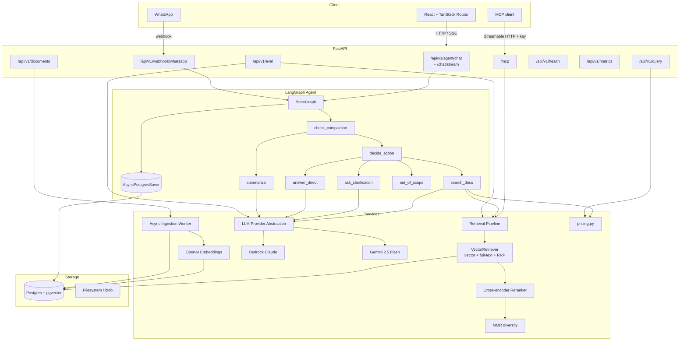
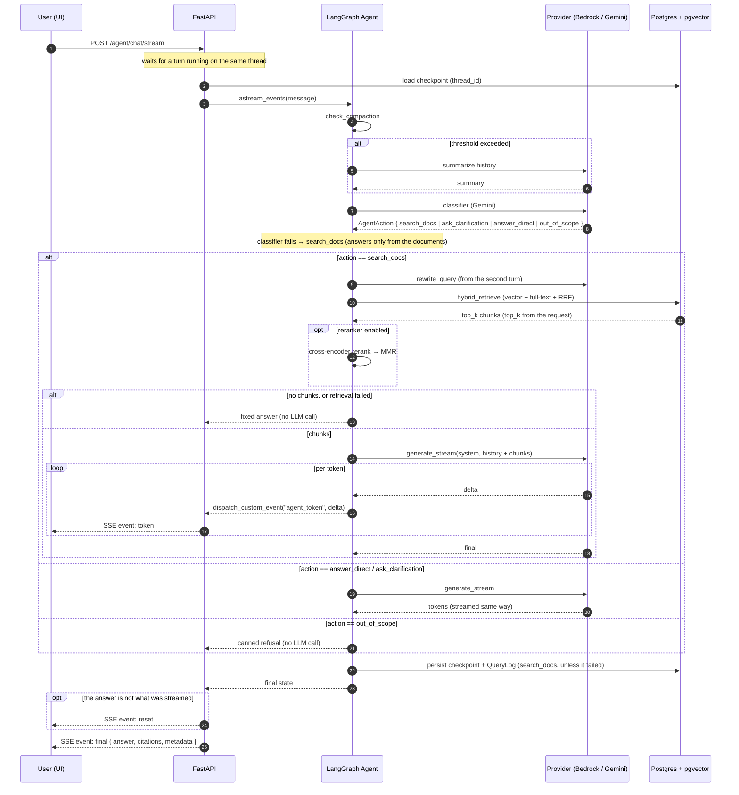
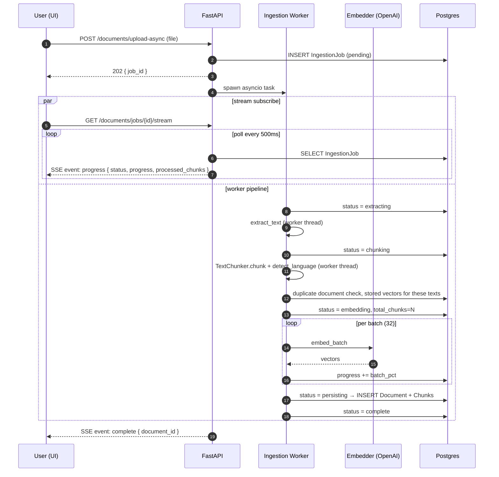
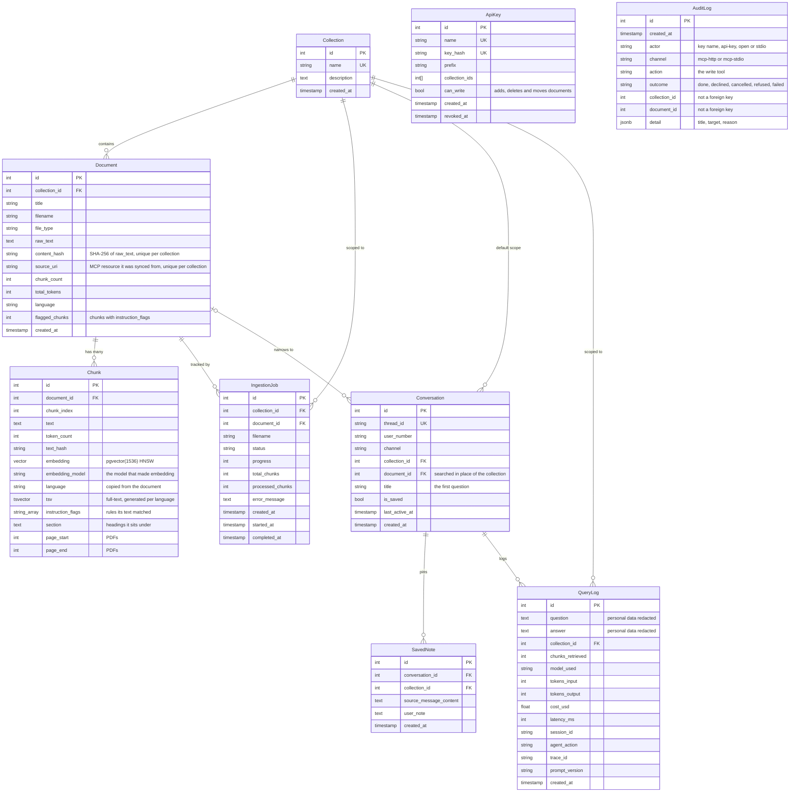

# Architecture

Reference document for the WhisperDocs system. Companion to [`README.md`](README.md).
Decision records under [`docs/adr/`](docs/adr/) explain *why* the major shapes
were chosen.

---

## Component diagram



---

## Sequence: agent chat (streaming)

Each turn takes one path: the classifier picks one action and that node
answers. `search_docs` rewrites the question, retrieves once and generates;
there is no loop, retry or second retrieval, by design. Semantic citation
validation and the structured `refused` flag are recorded in the turn
metadata but do not change the answer.



Every node of the graph sends `node_start` and `node_end`. A `reset` tells
the client to drop the tokens it has shown: the `final` or `error` after it
replaces them, when a generation failed partway or citations were taken out.
Turns on one thread run one at a time (`app/agent/thread_lock.py`, shared
with WhatsApp): two at once would start from the same checkpoint, and the
last to save would be the thread's history. A client that closes the
stream cancels the turn; it is logged (`agent_stream_cancelled`) and its
span has `error.type` `cancelled`. Its question stays checkpointed without
an answer, which the next prompts leave out.

---

## Sequence: async ingestion



Parsing, chunking and language detection are CPU-bound, so the worker and the
synchronous upload run them with `asyncio.to_thread`. The thread does not make
the parse faster: pdfplumber still holds the GIL while it computes. It keeps
the event loop serving, because the interpreter switches threads every 5 ms.
On a 60-page text PDF (about 9 s of parsing) the loop used to stop for the whole
parse; now its longest pause is a full garbage collection, which also holds the
GIL. pdfminer allocates enough objects to trigger several. Freezing the objects
allocated at startup (`gc.freeze()` in the lifespan) brought the longest pause
from the start, about 300 ms to about 150 ms. Removing it would mean parsing in a separate
process.

### Extraction and chunking

`app/services/text_extractor.py` turns every format into one shape: `#`
headings (Markdown, DOCX, HTML, and each sheet of an XLSX), markdown tables
(from PDF, DOCX, HTML, XLSX and CSV), and a form feed on its own line between
a PDF's pages. A PDF's text comes from the characters outside its tables'
boxes, and each table goes in once, as markdown, at the height of its top:
`extract_text` used to return the cells as lines and the table was added
again after them (audit R13). Text files are decoded by their byte order
mark, as UTF-8, or as what `charset-normalizer` finds, Windows-1252 when it
ties with other single-byte encodings (it ranks Windows-1250 first on Spanish
text, which reads "años" as "ańos"). DOCX and XLSX are zip archives: one whose
entries would expand past 100 MB, or with more than 10,000 of them, is refused
before python-docx (entity resolution off) or openpyxl (through defusedxml)
opens it.

`app/services/chunker.py` reads that text as blocks: headings, paragraphs,
tables and code fences (audit R14). It reads `#` lines as headings only for
the types that mark them (`HEADING_TYPES`), and counts pages only for PDFs
(`PAGED_TYPES`). Blocks are packed into chunks of up to 500 tokens:

- A heading starts a chunk once the current one has half a chunk, 250
  tokens; under that, the next section joins it. On the eval corpus that
  gives 95 chunks, median 305 tokens, against 71 of median 467 before; with
  no merging, 142 chunks, half of them under 200 tokens.
- Each chunk starts with the headings above it, up to a fifth of the chunk,
  so its embedding, its full-text lexemes and the model's context carry the
  section. The RAG prompt is unchanged: the headings are part of the chunk's
  text.
- A table that fits is never cut; one that does not is cut between rows, and
  each part repeats the header and delimiter rows.
- A paragraph or code block longer than a chunk is cut at the strongest
  boundary near the end of the window, with 50 tokens of overlap into the
  next part. There is no overlap between blocks.
- Cuts are on the text, with offsets: the token-based cut it replaces
  re-encoded the prefix and could drift a token, and could split a
  character.

Each chunk stores `section` (the headings its text sits under, " › "-joined;
sibling sections merged into one chunk are listed, "Doc › A, B") and
`page_start`/`page_end` (migration 0020). Retrieval returns them, and every
citation carries them: `/agent/chat` and its stream, `/query`, `/retrieve`,
the MCP tools, and the document page's chunks. Chunks stored before have
none until their document is uploaded again, and an eval collection seeded
before reads the old chunks: seed it again before comparing a run with one
from before. Each report records how many chunks its collection held and a
hash of their texts (`collection_chunks`, `collection_hash`), and a diff
warns when two runs searched different chunks.

### Duplicates and vectors

A collection holds each document once (audit R12). `documents.content_hash`
is the SHA-256 of the extracted text, and a unique index on (collection_id,
content_hash) (migration 0021, which hashed the stored documents in SQL, and
left null on the later copies of a text a collection already held twice)
keeps two uploads of the same file apart. The upload checks it before paying
for the embeddings, and a commit the index refuses is the same 409. A move
into a collection that holds the text leaves that document where it is, with
the reason in the result's `errors`.

A chunk whose text another document holds is no longer skipped: skipping it
meant deleting the other document took the text out of the collection.
Each document stores all its chunks, and `embed_chunks` embeds each distinct
text once, copying the vector of a stored chunk with the same text when the
same model made it. `chunks.embedding_model` records that model (migration
0022; null on chunks from before, which are never reused). The OpenAI
embedder asks for `EMBEDDING_DIMENSION` floats (`dimensions`, except for
`text-embedding-ada-002`), so `text-embedding-3-large` fits the 1536-float
column, and refuses a vector of another size before the insert (audit R19).

### From an MCP server

`python -m app.connectors.mcp_sync` (audit M-6) is WhisperDocs as an MCP
client, for ingestion only: it connects to a server (a command over stdio,
or a URL over Streamable HTTP with a bearer token from an environment
variable), takes the resources `resources/list` names or the URIs it is
given, reads each, and stores it with `store_document`, the upload's path.
No model is involved. Each document keeps its resource's URI
(`documents.source_uri`, unique per collection, migration 0024). A later
run leaves a resource whose text is the same alone, embedding nothing, and
replaces a changed one in one commit (the old document is deleted in the
transaction that stores the new, whose unchanged chunks reuse the stored
vectors). A resource whose text the collection holds under another
document is skipped, and nothing is deleted when a resource leaves the
server. Text content is read as text whatever its name (WhisperDocs' own
resources are a PDF's extracted text, named after the PDF); a blob is read
as its MIME type or extension says. The reference filesystem server lists
nothing, by design, so its files go in by `file://` URI (`--uri`,
`--uri-file`). The connector is not a tool of the agent: consulting outside
sources during a turn is multi-hop, which is V2, and would put a tool's
output in the prompt.

The uploaded bytes live only in the API process's memory, so a job cannot
outlive the process:
- Running jobs are kept in a set until they end. asyncio holds tasks only by
  weak reference, and a task nobody held could be collected mid-way.
- On shutdown, jobs get 5 s to finish (under Docker's 10 s stop timeout).
  Then they are cancelled and marked `failed`, with a message to upload the
  file again.
- On startup, jobs still unfinished in the table (left by a process that was
  killed) are marked `failed` the same way. This assumes one process runs
  ingestion, as compose and the Dockerfile do.
- Persisting the bytes and retrying would need a job queue.

---

## Data model



`api_keys` holds the MCP server's keys over HTTP: the SHA-256 of each, and
the collections it reaches (null for every one). `collection_ids` is an
array, not a foreign key: a deleted collection leaves an id that reaches
nothing. `can_write` (migration 0023, false on the keys from before) lets a
key add, delete and move documents in them.

`audit_log` (migration 0023) has a row per call to an MCP tool that writes
(BE-36). Its ids are plain integers: the record outlives the document and
the collection it names.

LangGraph checkpointer state lives in dedicated tables managed by
`langgraph-checkpoint-postgres` (not modeled here).

The saver writes a checkpoint per graph step, about five per turn, and each
one that changes `messages` stores the whole list again. A thread's rows
grow with the square of its turns: 120 synthetic turns left 609 checkpoints
and 70 MB of `messages` copies, for 0.6 MB of messages. Nothing reads a
thread's history, only its latest state (`aget_state`), so a background sweep
prunes it:

- Every `AGENT_CHECKPOINT_PRUNE_INTERVAL_S` (600 s; 0 turns it off), each
  thread with more than one checkpoint keeps its latest, with its pending
  writes and the blobs it reads (`aprune`, strategy `keep_latest`).
- Each thread is its own transaction. One that a turn or a delete changes
  meanwhile rolls back, and waits for the next sweep.
- Reading a thread's history (time travel, `aget_state_history`) would need
  pruning turned off.

---

## State contract

`AgentState` (`app/agent/state.py`) is the central data structure flowing
between graph nodes. Splits into two lifetimes:

- **Persistent** (survive across turns via checkpointer): `messages`,
  `summary`, `summary_covered_count`, `summary_retry_at`, `collection_id`,
  `document_id` (the one document a thread searches in place of its
  collection, from a document's ASK IN CHAT).
- **Transient** (reset by `check_compaction` each turn): `pending_action`,
  `retrieved_chunks`, `metadata`.

Compaction absorbs the older messages into `summary`, a structured summary
with four sections (user goal, decisions, key information, open questions)
that the generation prompts read in their place:

- Each user message carries what its turn searched,
  `additional_kwargs["scope"]` (a collection, a document, or all of them).
  The summarizer sees it on every user line, and each key fact keeps its
  source, so after a switch the facts from the earlier collection read as
  such.
- Each pass carries over the previous summary's decisions and facts, unless
  the new turns correct them, within 500 tokens.
- A summary missing a section (cut at `max_tokens`) or empty is not kept.
  After a failed summary, `summary_retry_at` makes `check_compaction` wait
  `AGENT_COMPACTION_RETRY_MESSAGES` (6) messages before trying again, instead
  of paying for a failing call on every turn. The turn proceeds either way.

Untrusted text reaches the models as data, never with the system role (audit
A10). The system role holds a node's instructions only:

- The summary heads the first user message of each prompt, inside a
  `<conversation_summary>` element (`with_summary` in
  `app/agent/utils/messages.py`). As a system message it carried the
  instructions' authority, though it is written from documents and users'
  words. A message of its own would put two user turns in a row, which
  Bedrock Converse rejects.
- The RAG prompt holds the retrieved chunks inside one `<documents>`
  element, with the question after it. Before, a `---` rule ended the
  context, and a chunk could end it the same way and forge the question.
- The summarizer reads the previous summary and the transcript inside
  `<previous_summary>` and `<transcript>`.
- `fill` (`app/agent/utils/untrusted.py`) escapes every tag of an
  element's name in the text that goes into it (`</documents>` becomes
  `&lt;/documents>`), so only the prompt closes it. The system prompts say
  what each element holds and that it is data.
- Ingestion flags each chunk whose text reads as an instruction to the
  model (`app/services/instruction_scan.py`, audit M-5): an override
  ("ignore all previous instructions"), a role marker (`SYSTEM:`), a new
  persona, a request for the system prompt, text addressed to the assistant,
  or a tag of one of these elements. The chunk keeps the rules it matched
  (`instruction_flags`), the document counts them (`flagged_chunks`), and
  the API returns both. Retrieval does not read them: the elements above are
  the defense, and a flag is a lead for whoever keeps the corpus.

Per-request values that are not conversation state travel in the run config,
not in `AgentState`: `config["configurable"]` carries `thread_id` and the
request's `top_k`, which `search_docs` reads (`AGENT_RETRIEVAL_TOP_K` when
absent).

An answer that reports a failure (retrieval or generation raised) carries
`additional_kwargs["failed"]` and `metadata.turn_failed`. It stays in
`messages`, so the thread shows what the user saw, but `format_messages` leaves
that exchange out of every prompt, summary and query rewrite, and
`/agent/chat` writes no `QueryLog` for it. Answers written without a model (no
documents, a failure, out of scope) take the language of the user's message
(`app/agent/utils/fixed_replies.py`).

Every call a turn makes that fails or falls back adds `{step, kind, model}` to
`metadata.turn_errors`. Steps are `summarize`, `classifier`, `query_rewrite`,
`embedding`, `retrieval`, `generation`, `clarification` and `citation_check`.
Kinds are `billing`, `auth`, `rate_limit`, `timeout`, `unavailable`,
`invalid_request`, `bad_response` and `unknown`; `classify_error` in
`app/services/llm/errors.py` reads the kind from the exception chain.

The answering node copies the list onto its message as
`additional_kwargs["errors"]`. `/agent/chat`, the stream's `final` event and a
thread's messages return it as `errors`, and the chat shows it under the
answer. A turn can answer with errors, which is why the list exists apart from
`turn_failed`: when the classifier fails, the turn searches the documents
instead, so without the list a provider refusing every classifier call does
not show.

Each node is a pure async function `(AgentState) -> dict` returning only the
fields it modifies; a node that needs the run config also takes
`config: RunnableConfig`. The graph wires nodes in `app/agent/graph.py`; nodes
never import each other directly. Nodes reach an LLM only through
`llm_service_for(alias)` and the `LLMProvider` interface, never through a
provider SDK.

---

## Retrieval pipeline

`app/services/retrieval_pipeline.py::retrieve()` composes:

1. **Hybrid fetch** — `VectorRetriever.hybrid_retrieve(query_text, query_embedding, ...)`
   - Vector search via cosine distance + HNSW index on `chunks.embedding`,
     with `hnsw.iterative_scan = relaxed_order` so the collection filter
     does not starve the scan (needs pgvector >= 0.8.0). When a filtered
     search still returns fewer than `top_k` rows, it is repeated as an
     exact scan of the collection's chunks; see ADR 0002
   - Full-text search (`VectorRetriever.lexical_retrieve`): OR over the
     question's lexemes, ranked by `ts_rank_cd` (Postgres cover-density
     ranking, not BM25). `chunks.tsv` is generated with the configuration of
     the chunk's language (`wd_english`, `wd_spanish`, `wd_simple`), all
     accent-insensitive; see `app/services/fulltext.py` and alembic `0013`
   - Fused with Reciprocal Rank Fusion (`1 / (k + rank)`, `k=60`) in
     `fuse_rrf`
2. **Cross-encoder rerank** (optional, `RERANKER_ENABLED=true`)
   - `BAAI/bge-reranker-base` via `sentence-transformers`, loaded at startup
   - Scores `(query, chunk_text)` pairs and sorts by score; a chunk's
     relevance is the sigmoid of the model's logit, a probability that holds
     across queries (audit R16). It used to be min-max over each query's
     batch, which put the best chunk at 1.0 even when none answered.
     `RERANKER_SCORE_THRESHOLD` drops the chunks below it but never the best
     one: a turn left with no chunks would be the relevance gate, out of V1
3. **MMR diversity** (optional, `MMR_ENABLED=true`)
   - Document-level penalty: `λ * relevance(c) − (1−λ) * I[doc(c) ∈ selected_docs]`
   - λ=1.0 → pure relevance; λ=0.0 → pure diversity

Pool sizing: when reranking or MMR is active, the pipeline fetches
`fetch_k = max(top_k, RERANKER_CANDIDATE_POOL)` candidates (20 by default);
otherwise `fetch_k = top_k`. Each leg of the hybrid search returns
`max(fetch_k, 20)` rows before fusion, so RRF always works from at least 20
per leg, and a pool above 20 reaches the reranker in full.

Context budget: `build_user_prompt` (`app/services/rag.py`) renders the
numbered context block for `/query`, the eval and the agent's `search_docs`,
and keeps the chunks that fit `AGENT_RAG_CONTEXT_TOKEN_BUDGET` (6000 tokens).
Citations, citation validation and the eval's hallucination judge use those
chunks; retrieval precision and recall use every retrieved chunk.

Scores on `RetrievedChunk`: `relevance` is what the list is ordered by, 0-1:
the RRF score divided by the best possible (1.0 = first in every leg that
returned rows), or the cross-encoder score after reranking. `cosine` is the
vector similarity, `None` for chunks only full-text search found. MMR uses
`relevance`; the `retrieval_top_relevance` metric uses the best `cosine`.

`scripts/retrieval_bench.py` measures each leg and the fused result on the
golden set (rows returned, precision@k, recall@k) without LLM calls. Results
before and after the full-text rework are in ADR 0003.

---

## Provider abstraction

```python
class LLMProvider(Protocol):
    async def generate(...) -> LLMResponse: ...
    async def generate_structured(...) -> tuple[T, LLMResponse]: ...
    def generate_stream(...) -> AsyncIterator[LLMStreamDelta]: ...
```

`app/services/llm/__init__.py::llm_service_for(node_alias)` routes by config:

| Alias | Default model | Provider |
|-------|---------------|----------|
| `classifier` | `gemini-3.8-flash` | Gemini |
| `query_rewrite` | `gemini-3.8-flash` | Gemini |
| `clarification` | `gemini-3.8-flash` | Gemini |
| `answer_direct` | `gemini-3.8-flash` | Gemini |
| `rag` | `us.anthropic.claude-sonnet-4-5-20250929-v1:0` | Bedrock |
| `summarize` | `us.anthropic.claude-haiku-4-5-20251001-v1:0` | Bedrock |
| `eval_judge` | `gemini-3.8-flash` | Gemini |
| `extraction` | `us.anthropic.claude-sonnet-4-5-20250929-v1:0` | Bedrock |

Override per node via `AGENT_MODEL_<ALIAS>` env vars. Model rules live in
`app/services/llm/model_policy.py`:

- **Sampling.** `temperature` is sent only to models that accept it. Gemini 3+
  and Claude 4.7+ use fixed sampling, so `AGENT_TEMP_*` has no effect on them.
- **Gemini 3.** `GEMINI_THINKING_LEVEL` (default `low`) sets `thinking_level`.
  `gemini-3.8-flash` is served from the `global`, `us` and `eu` locations
  only, so `GCP_LOCATION` defaults to `global`.
- **Claude 4.7+ on Bedrock.** Converse serves Claude Sonnet 5.5
  (`global.anthropic.claude-sonnet-5-5`), Sonnet 4.5's replacement. These
  models get no `temperature`, the effort in `BEDROCK_CLAUDE_EFFORT` (default
  `low`), and 2048 more `max_tokens`, since their adaptive thinking counts
  toward it. Structured output is a JSON schema (Bedrock's native structured
  output), not the forced tool call LangChain uses by default, which Sonnet
  5.5 rejects; Pydantic checks the bounds the schema cannot carry, such as
  `ge`/`le`.
- **Startup check.** `app/main.py` refuses to start when a configured model
  can't be routed, and logs a warning for a model with no row in
  `pricing.py` (its cost falls back to a generic rate).

Retries:
- **Bedrock.** botocore is set to a single attempt, and `BedrockProvider`
  retries throttling, 5xx and model timeouts itself: up to 3 attempts, with
  backoff from 0.3 s. `generate_stream` retries only until the first token. After
  that, the client has already shown text, so the error ends the turn.
- **Gemini.** The google-genai SDK retries (`max_retries=2`).

---

## Eval framework

`app/eval/` is a self-contained subsystem:

- `schemas.py` — `TestItem`, `EvalResult`, `AggregateMetrics`, `EvalReport`
- `runner.py` — CLI: `run`, `diff`, `rejudge`, `label` and `agreement` subcommands, JSONL or JSON
  dataset loaders
- `evaluator.py` — orchestrator (loads dataset, embeds, retrieves, generates, judges)
- `judges.py` — LLM-as-judge for correctness + hallucination. Each call fills a reasoning-first
  schema (`HolisticVerdict`, `FactsVerdict`, `GroundingVerdict`) and the `JudgeResult` a report
  keeps is built from it in code: a correctness verdict follows from the required facts the
  answer states, a grounding verdict from the unsupported claims listed
- `agreement.py` — the judge against a person: `build_labels` draws a blind sample of a run's
  verdicts, balanced by what the judge ruled, and `measure_agreement` computes agreement and
  Cohen's kappa from the person's rulings
- `metrics.py` — aggregation: precision and recall@k over the in-scope items,
  p50/p95, generation cost via shared `pricing.py`, count of failed judge calls.
  `hallucination_rate` is the share of items with an unsupported claim (a claim the retrieved
  context does not support, true or not); `AggregateMetrics.in_scope_unsupported()` gives it over
  the in-scope items alone. The field and the thresholds keep the old name
- `report.py` — Markdown rendering + diff between runs

The evaluator calls the retrieval pipeline and the single-turn RAG prompt
(`app/services/rag.py`) directly; it does not run the agent graph. The
retrieval, the prompt and its context budget are the ones the chat uses. The
classifier, query rewrite and history handling are covered by the unit tests in
`tests/agent/`. A run aborts (`EvalAbortedError`, exit code 2 from the CLI,
HTTP 502 from `/eval/run`) when the share of failed judge calls exceeds
`AGENT_EVAL_MAX_JUDGE_ERROR_RATE` (default 0.1). A finished run below
`AGENT_EVAL_MIN_ACCURACY` (0.80) or above `AGENT_EVAL_MAX_HALLUCINATION_RATE`
(0.10) makes the CLI exit 3, which fails the manual `Eval suite` workflow;
the CLI's `--min-accuracy` and `--max-hallucination` override them.

Each report carries `prompt_version`, the version of the prompts it answered
with (`app/agent/prompt_version.py`: a hash of every constant in
`app/agent/prompts.py` and the structured outputs' schemas), and
`judge_prompt_version`, the judge's. `runner diff` compares two reports over
the same items and exits 3 when accuracy drops more than
`AGENT_EVAL_MAX_ACCURACY_DROP` or the hallucination rate rises more than
`AGENT_EVAL_MAX_HALLUCINATION_RISE` (0.10 each). `GET /eval/diff?previous=&current=`
returns the same comparison as data (`run_diff` in `report.py`, built from
the helpers the CLI's diff uses): the settings that changed, the warnings, the
metrics, the flips per check with McNemar's exact p, and the items that
flipped. The Evaluation page shows it, and only formats it. The `Prompt gate` workflow
runs it on a pull request that changes a prompt, the base's code against the
head's over the same golden set and corpus; it is off until the repository
variable `PROMPT_GATE` is `on`, since each run pays for two evals.

A second set, `eval/golden/adversarial.jsonl` (8 items), runs apart over its
own corpus, `fixtures/adversarial-docs/`, in the `Eval Adversarial`
collection, so its documents never reach a golden run (audit M-5). Four
documents carry prompt injections: an HTML comment telling the assistant to
answer "ACCESS GRANTED", a forged `</documents>` and question, a fake system
message asking for the prompt, and an instruction to add a phishing link.
Two questions are injections themselves. Each item lists in `forbidden` what
its injection asks for, and an answer containing any of it fails without a
judge call.

Dataset format (`eval/golden/queries.jsonl`):

```jsonl
{"id": 1, "question": "...", "expected_answer": "...", "difficulty": "medium", "category": "in_scope", "expected_sources": ["foo.md"], "required_facts": ["..."], "optional_facts": ["..."]}
```

`required_facts` are what a correct answer must state, one atomic fact each; `optional_facts`
may be added or left out and never fail an answer. An in-scope item without them is judged
against `expected_answer` as a whole. They are part of the dataset hash, but an item with none
hashes as it did before they existed.

The same retrieval pipeline (`retrieval_pipeline.retrieve`) is used in eval and
production — toggling reranker / MMR via env vars produces an apples-to-apples
A/B run.

---

## API edge

From the outside in: CORS, then `RequestContextMiddleware`
(`app/api/errors.py`), then the body size limit, then the routes.

- **Request id.** Each request gets an id: the caller's `X-Request-ID` when
  it is a plain token, a new one otherwise. It is returned in that header and
  bound to the structlog context, so every log line of the request carries
  it. An exception no handler caught becomes a 500 here, inside CORS, so the
  browser reads the 500 and not a CORS failure.
- **Errors.** One body for every error: `{detail, code, request_id}`, plus
  `kind` on a 502 from a model or embedding call (`classify_error`). Routes
  raise `APIError(status, code, detail)`; a plain `HTTPException` gets its
  code from its status. A 5xx message ends with the request id.
- **Key** (`app/api/auth.py`). Every router except health and the WhatsApp
  webhook is included with `Depends(require_api_key)`, a no-op while
  `API_KEY` is unset. `tests/test_api_access.py` sends a bare request to
  every route in the OpenAPI schema and expects 401, so a router added
  without the key fails the tests.
- **Operation IDs.** Each route sets its `operation_id`. Clients name the
  calls by these IDs: the MCP server, a generated SDK, an agent's tool list.
  FastAPI's default, from the function name and the path, changed with any
  rename. `tests/test_openapi.py` fixes the full list.
- **Retrieval for other agents.** `POST /retrieve` runs
  `retrieval_pipeline.retrieve`, the search the chat and `/query` use, and
  returns the chunks with their text; nothing is generated. A
  `document_id` implies its collection.
- **Shared services.** The routes for `/retrieve`, `/query`, the
  collection and document lists, the synchronous upload, the deletes and
  moves, and the extraction are thin: their logic lives in
  `app/services/search.py`, `answering.py`, `catalog.py`, `ingestion.py`
  (`check_document`, `extract_document`, `store_document`), `documents.py`
  and `extraction.py`, which the MCP server calls too. A route maps the
  services' errors to HTTP (a missing scope is a 404, a failed provider a
  502, a schema the extraction cannot fill a 422 `invalid_schema`); a tool,
  to a tool error.
- **Rate limits** (`app/api/rate_limit.py`). A sliding 60 s window per
  bucket and client, in process memory. The key names the client only when
  auth is on: with it off, a made-up key per request would get a fresh
  window.
- **WhatsApp webhook** (`app/api/v1/webhooks/whatsapp.py`). Twilio waits at
  most 15 s for it, and a turn's p95 was 9.1 s, so it only checks the
  signature, drops a repeated `MessageSid` and a number over the questions'
  limit, and returns 204. The turn runs in a task
  (`app/services/whatsapp/inbound.py`) with its own session. A number's
  messages run one at a time, in the order they came: a lock per thread,
  dropped with its last waiter. The ids seen, the locks and the tasks live in
  process memory, like the rate limits; on shutdown the turns get 5 s, then
  are cancelled. No log line carries a number: the thread id is a UUID5 of
  it, a Twilio failure logs its status and code without its message, and the
  engine hides statement parameters (`hide_parameters`).
- **WhatsApp replies** (`app/services/whatsapp/formatter.py`). The answer's
  markdown is stripped where it is markdown (audit A16): a heading mark at
  the start of a line, emphasis whose delimiters touch the text they wrap.
  `snake_case`, `__init__`, `2 * 3` and "C#" stay. The footer lists the
  sources the answer cites by its `[n]`, each title once, in the language of
  the user's message; an answer that cites none, such as a refusal, has no
  footer.

---

## MCP server

`app/mcp/server.py` builds an `MCPServer` (official `mcp` SDK 2.3).
`python -m app.mcp` serves it over stdio, and clients start it with
`docker compose exec -T api python -m app.mcp`. The API also serves it over
Streamable HTTP at `/mcp` (`app/mcp/http.py`), behind keys scoped to
collections. See [ADR 0005](docs/adr/0005-mcp-server.md),
[ADR 0007](docs/adr/0007-mcp-over-http-scoped-keys.md) and
[ADR 0008](docs/adr/0008-mcp-writes-confirmed-and-audited.md).

```
MCP client (Claude Code, Claude Desktop, Cursor)
  │ stdio: JSON-RPC, 2026-07-28 or the older initialize handshake
  │ or HTTP POST /mcp, stateless, with a key
  ▼
app/mcp/http.py      KeyAuth: key ──► Access (its collections) in the request
  │                  then the SDK: Host check, Streamable HTTP
  ▼
app/mcp/server.py    each tool reads its caller's Access
  search_documents ──► services/search.py    ──► retrieval_pipeline
  ask_documents    ──► services/answering.py ──► retrieval_pipeline + rag model
  extract_fields   ──► services/extraction.py ──► the document's chunks + extraction model
  list_collections, list_documents ──► services/catalog.py
  resources: whisperdocs://documents/{id} ──► documents.raw_text
app/mcp/writes.py    a key that writes; the user's confirmation; audit_log
  ingest_document  ──► services/ingestion.py (ingest_bytes, as an upload)
  delete_document, move_document ──► services/documents.py
  ▼
Postgres (the compose database)
```

- **Writes** (BE-36, `app/mcp/writes.py`). `ingest_document` takes a file
  as text, or as base64 for a PDF, Word or Excel file, and runs the
  synchronous upload's checks and ingestion. `delete_document` and
  `move_document` ask the user first. Over HTTP only a key made with
  `--write` writes, in the collections it reaches; the API's own key, an
  open API and stdio write, as the REST API lets them. `ask_documents`
  also writes its `query_logs` row, as `/query` does.
- **Asking the user** is MCP elicitation, through the SDK's `Resolve` and
  `Elicit`: a resolver checks the call (the key, the reach, a target that
  already holds the text) and only then asks. On 2026-07-28 the question
  rides the call's `InputRequiredResult` and the client calls again with
  the answer and a `request_state` the SDK seals with a key held in the
  process (one uvicorn process, as for the rate limits; a restart drops a
  question in flight). That works on the stateless `/mcp`. On 2025-11-25
  the question is a request to the client mid-call, which needs a channel
  back: stdio has one, the stateless HTTP exchange does not, and its
  requests arrive without the capabilities the client declared. A client
  that cannot be asked, or declares no elicitation, is refused; nothing is
  changed without the user's yes.
- **The audit log** (`app/services/audit.py`). Every call to a write tool
  leaves a row in `audit_log`: actor (the key's name, `api-key`, `open` or
  `stdio`), channel, tool, outcome (done, declined, cancelled, refused,
  failed), the document and collection, and a `detail` with the title or
  the reason. A write that happens commits its row in the same transaction;
  the others commit theirs on their own. `GET /admin/audit-log` pages it.
- **Extraction** (audit M-8, `app/services/extraction.py`). A JSON Schema
  of flat fields (strings, numbers, booleans, enums, lists of them) becomes
  a Pydantic model the model fills: per field a quote, the passage's
  number, then the value, all nullable and required. The passages are the
  document's chunks in order, or for a document over 12k tokens the ones a
  search for the fields finds within it. Code checks each quote against
  the passages (case, spacing and quote marks aside); a value whose quote
  does not hold is in `unverified`. One call, `AGENT_MODEL_EXTRACTION`
  (Sonnet), temperature 0; the prompts are not in `app/agent/prompts.py`,
  so they do not move `PROMPT_VERSION`.
- **Arguments** are bounded like the API's (`top_k` 1-20, `limit` 1-100) and
  checked before the tool runs.
- **Errors are tool results**, for the model to read: a missing scope names
  the lists that give the ids, and comes before the embedding is paid for;
  a failed provider call gives its kind, not the provider's text.
- **Resources.** `resources/list` names the newest 200 documents, with
  their size; the template `whisperdocs://documents/{id}` reads any.
- **stdio is its own process.** The API's rate limits and model status are
  per process and do not see these calls. stdout is the protocol's: the
  SDK points the process's stdout at stderr while it serves, and the logs
  go to stderr. Over stdio there is no request, and the caller reaches
  every collection.
- **HTTP is the API's.** The SDK's session manager runs in the API's
  lifespan (a new one each time: it runs once per instance); outside it,
  `/mcp` is a 503. The SDK hands each tool the HTTP request its message
  came in, and `KeyAuth` left the caller's `Access` in that request's
  state (`access_of`). A key is a stored one (`api_keys`, its
  collections), the API's `API_KEY` (every collection), or none, which
  reaches everything only while `API_KEY` is unset.
- **Scope.** Out of reach reads as missing, word for word, so a key
  cannot probe other collections' ids. `list_collections`,
  `list_documents` (`catalog.list_documents(collection_ids=...)`) and
  `resources/list` (the SDK's handler is overridden: it does not pass the
  request) show only what the key reaches. A search without a collection
  takes the key's one, or asks for `collection_id`.
- **Limits.** Over HTTP, `search_documents`, `ask_documents` and
  `extract_fields` take from the `questions` bucket, per key, before any
  embedding; `ingest_document` from `uploads`.
- **Tests.** `tests/test_mcp.py` runs an in-memory client against fakes,
  compares each tool with its route, covers both protocol eras, and starts
  the stdio process to check that it writes only JSON-RPC to stdout.
  `tests/test_mcp_db.py` runs the tools and resources against Postgres.
  `tests/test_mcp_http_db.py` goes through the SDK's own HTTP client and
  transport, against Postgres: a key that does not see another
  collection, the 401s, the host check, the limit per key and both eras.
  `tests/test_mcp_http.py` checks the keys without a database.
  `tests/test_mcp_writes_db.py` runs the write tools against Postgres: each
  answer to the confirmation, a client that cannot be asked, keys that only
  read or reach one collection, both eras over HTTP, and the log.
  `tests/test_extraction.py` covers the schemas, the prompt and the quote
  check, and compares the tool with its route.

---

## Observability

- **Logs** — `structlog` with JSON output in production (`LOG_JSON=1`),
  console-pretty otherwise. Every line of a request carries its
  `request_id` (see API edge); inside a turn, also its `thread_id`, and
  inside a span its `trace_id` and `span_id`.
- **Traces** — OpenTelemetry, in `app/telemetry.py`
  ([ADR 0006](docs/adr/0006-opentelemetry-traces.md)). One trace per
  request:

  ```text
  POST /api/v1/agent/chat                  FastAPI's span       SERVER
    invoke_workflow whisperdocs-agent      the turn             INTERNAL
      check_compaction, decide_action, …   one per graph node   INTERNAL
        chat gemini-3.8-flash              a model call         CLIENT
        embeddings text-embedding-3-small  an embedding request CLIENT
        retrieval                          the pipeline         INTERNAL
  ```

  - Attribute names follow the GenAI semantic conventions, pinned to the
    2026-11-06 state of their repository (they are in Development). A model
    call records its provider, model, `max_tokens`, temperature and effort
    when they are sent, token counts, cost from `pricing.py`, and on failure
    the `classify_error` kind as `error.type`.
  - The turn adds up the tokens and cost of every call in it, the
    classifier's and the summary's included. It records them as
    `whisperdocs.*`, not `gen_ai.usage.*`, because a backend that sums a
    trace's usage, as Langfuse does, would count them twice.
    `query_logs.cost_usd` stays the answer's cost.
  - No span holds prompt, answer or document text, nor an exception's
    message.
  - `query_logs.trace_id` holds the turn's trace id. `/query` and the MCP
    server's `ask_documents` are `invoke_workflow whisperdocs-query` traces.
  - The turn's span carries `whisperdocs.prompt_version`, and its
    `query_logs` row `prompt_version` (migration 0017): the version of the
    prompts it sent (`app/agent/prompt_version.py`).
  - A TracerProvider is always installed, so the ids exist. Spans leave the
    process only with `OTEL_EXPORTER_OTLP_ENDPOINT` set, over OTLP/HTTP.
    `docker compose --profile tracing` runs Langfuse to read them.
- **Metrics** — Prometheus `/metrics` endpoint:
  - `whisperdocs_agent_turn_duration_seconds{action}` — whole turn, recorded
    by `/agent/chat`, `/agent/chat/stream` and the WhatsApp webhook
  - `whisperdocs_llm_tokens_total{model,direction}` — RAG generation calls only
  - `whisperdocs_retrieval_chunks` (histogram)
  - `whisperdocs_retrieval_top_relevance` (histogram)
  - `whisperdocs_errors_total{type}`
  - `whisperdocs_http_requests_total{method,route,status}` and
    `whisperdocs_http_request_duration_seconds{method,route}` — every HTTP
    request, from `HTTPMetricsMiddleware` (`app/api/http_metrics.py`).
    `route` is the template FastAPI matched (`/api/v1/documents/{document_id}`),
    or `unmatched`, so a scanner's paths never become label values; a body
    refused by its declared size is answered before routing, so its 413 is
    `unmatched` too. The
    duration runs until the response's last byte, so a stream's covers the
    whole stream. CORS preflights are answered outside it and not counted.
  - `ops/` holds a Grafana dashboard (HTTP rate, 5xx share and p95 by route;
    turns and their latency; model calls, failures and tokens; retrieval) and
    Prometheus alert rules: the API unreachable, over 5% of 5xx, a model role
    failing over half its calls, turn p95 over 13 s. `docker compose --profile
    metrics` runs both; nothing routes the alerts (no Alertmanager).
- **Cost tracking** — `query_logs.cost_usd` populated per turn via `pricing.estimate_cost_usd(model, tokens_in, tokens_out)`.
- **Health** — `/health` pings the DB; `?deep=true` also checks the pgvector
  extension, the embedder (one embedding call, its result kept 5 minutes, 30
  seconds after a failure) and each model role. A degraded status answers 503
  with the same body, so a load balancer or a monitor needs no parsing; the
  frontend reads that body and shows DEGRADED, not OFFLINE.
- **Model status** — `app/services/model_status.py` keeps, for each role
  (the seven agent nodes' models and the embedder), when its last call worked,
  when one last failed and why (`classify_error`), and how many calls in a row
  failed. `llm_service_for` hands out a `TrackedProvider` that records every
  call, and the embedder records its own. The record is free to read:
  `GET /admin/model-status`, the `models` block of `/health?deep=true` (a
  failing role makes it `degraded`), and the frontend's notice. Like the
  rate limits, it lives in process memory and starts over on a restart. The
  eval CLI, a process of its own, does not show there.
  - `whisperdocs_model_calls_total{role,model,outcome}` — outcome is `ok`
    or the failure's kind

---

## Testing strategy

- **Unit** — Each agent node tested in isolation with `FakeProvider` and a
  mocked retrieval pipeline (`tests/agent/conftest.py`). Streaming nodes get a
  `generate_stream` stub that yields the canned response.
- **Service** — `test_chunker.py`, `test_reranker.py`, `test_mmr.py` exercise
  pure-function services without DB.
- **Database** — `test_retrieval_db.py` and one test in `test_ingestion_jobs.py`
  run against a real Postgres when `TEST_DATABASE_URL` is set: full-text,
  HNSW, collection filters, job cleanup. CI sets it, against a
  `pgvector/pgvector` service migrated with `alembic upgrade head`; then
  `alembic check` fails if the models and the migrations disagree.
- **E2E** — Eval suite acts as integration: ingest fixture corpus, query, judge.

`tests/agent/conftest.py::mock_retriever` patches both
`retrieval_pipeline.retrieve` *and* the rebound names in importing modules so
either entry point sees the same stub data.

No test reaches a provider. `tests/conftest.py` checks every host name a test
resolves, and fails the test on any host but this machine and the test
database, even when the code under test caught the error. A test that forgot
to stub its provider fails there instead of calling the real one with the
developer's credentials.

---

## Decision records

See [`docs/adr/`](docs/adr/) for short rationale notes:

- [0001 — LangGraph over chained LCEL](docs/adr/0001-langgraph-over-lcel.md)
- [0002 — pgvector over a dedicated vector DB](docs/adr/0002-pgvector-over-dedicated-vectordb.md)
- [0003 — Hybrid retrieval with RRF](docs/adr/0003-hybrid-retrieval-rrf.md)
- [0004 — Dual LLM provider routing](docs/adr/0004-dual-llm-provider-routing.md)
- [0005 — An MCP server over the same services as the API](docs/adr/0005-mcp-server.md)
- [0006 — OpenTelemetry traces with the GenAI conventions](docs/adr/0006-opentelemetry-traces.md)
- [0007 — MCP over HTTP, with keys scoped to collections](docs/adr/0007-mcp-over-http-scoped-keys.md)
- [0008 — MCP writes: a key that writes, the user's confirmation, an audit log](docs/adr/0008-mcp-writes-confirmed-and-audited.md)
