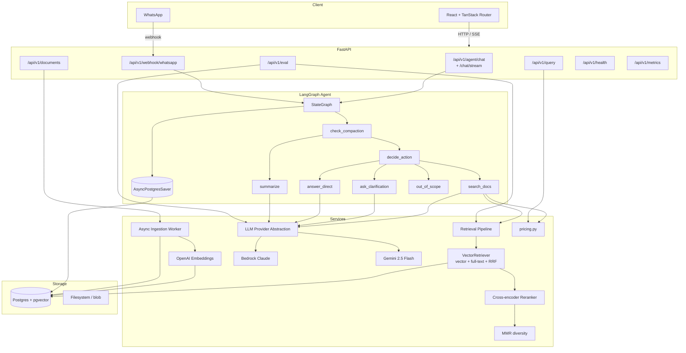
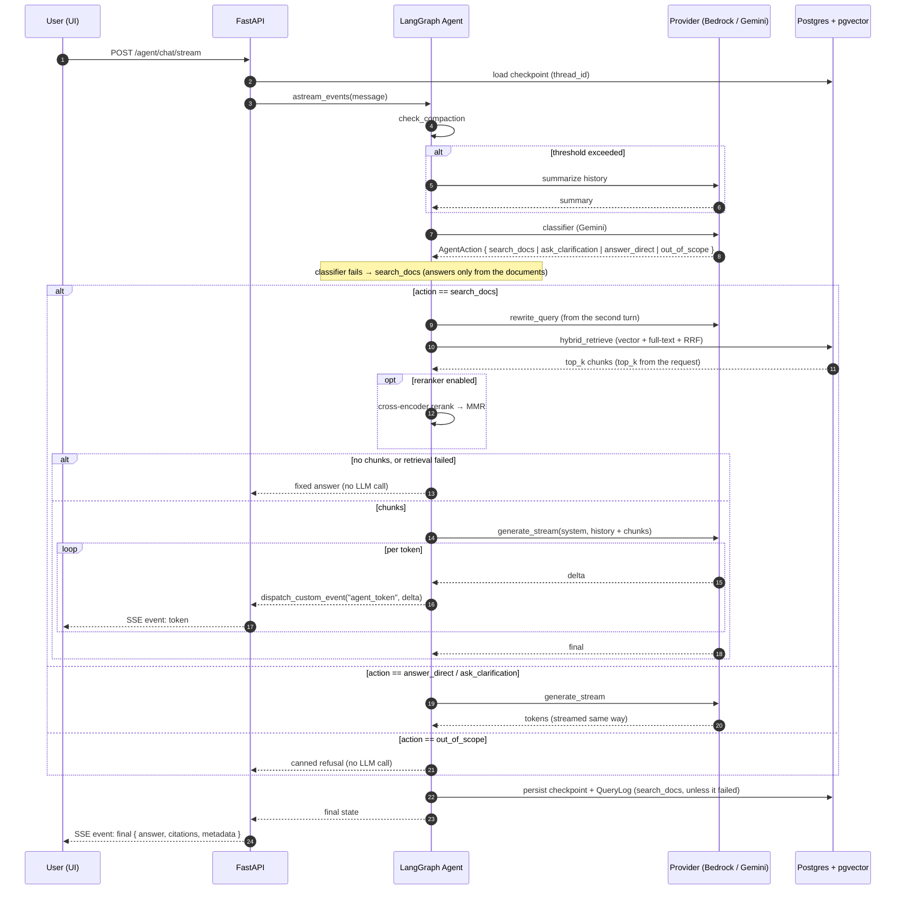
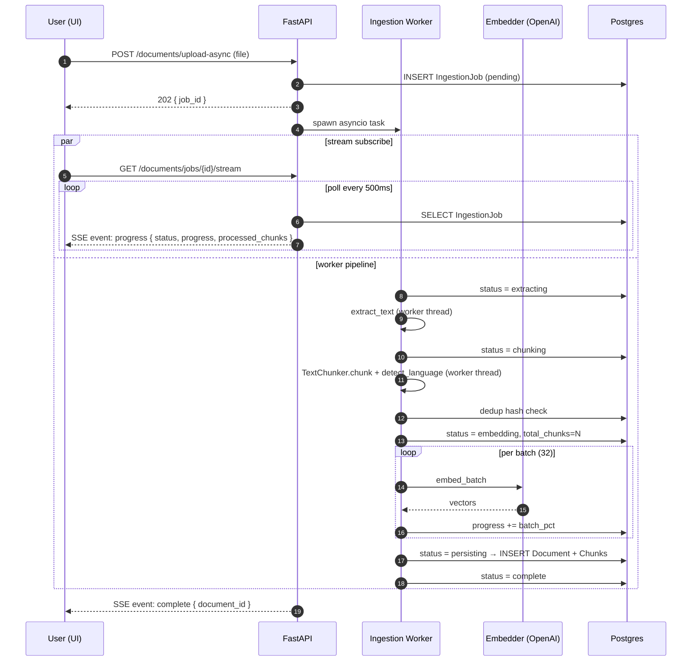
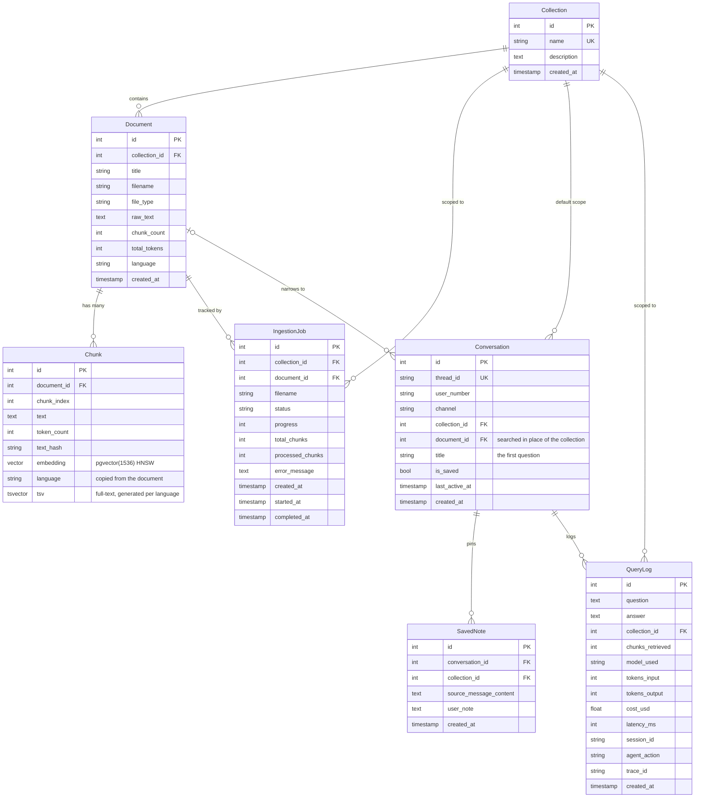

# Architecture

Reference document for the WhisperDocs system. Companion to [`README.md`](README.md).
Decision records under [`docs/adr/`](docs/adr/) explain *why* the major shapes
were chosen.

---

## Component diagram



---

## Sequence: agent chat (streaming)

Each turn takes one path: the classifier picks one action and that node
answers. `search_docs` rewrites the question, retrieves once and generates;
there is no loop, retry or second retrieval, by design. Semantic citation
validation and the structured `refused` flag are recorded in the turn
metadata but do not change the answer.



---

## Sequence: async ingestion



Parsing, chunking and language detection are CPU-bound, so the worker and the
synchronous upload run them with `asyncio.to_thread`. The thread does not make
the parse faster: pdfplumber still holds the GIL while it computes. It keeps
the event loop serving, because the interpreter switches threads every 5 ms.
On a 60-page text PDF (about 9 s of parsing) the loop used to stop for the whole
parse; now its longest pause is a full garbage collection, which also holds the
GIL. pdfminer allocates enough objects to trigger several. Freezing the objects
allocated at startup (`gc.freeze()` in the lifespan) brought the longest pause
from about 300 ms to about 150 ms. Removing it would mean parsing in a separate
process.

The uploaded bytes live only in the API process's memory, so a job cannot
outlive the process:
- Running jobs are kept in a set until they end. asyncio holds tasks only by
  weak reference, and a task nobody held could be collected mid-way.
- On shutdown, jobs get 5 s to finish (under Docker's 10 s stop timeout).
  Then they are cancelled and marked `failed`, with a message to upload the
  file again.
- On startup, jobs still unfinished in the table (left by a process that was
  killed) are marked `failed` the same way. This assumes one process runs
  ingestion, as compose and the Dockerfile do.
- Persisting the bytes and retrying would need a job queue.

---

## Data model



LangGraph checkpointer state lives in dedicated tables managed by
`langgraph-checkpoint-postgres` (not modeled here).

---

## State contract

`AgentState` (`app/agent/state.py`) is the central data structure flowing
between graph nodes. Splits into two lifetimes:

- **Persistent** (survive across turns via checkpointer): `messages`,
  `summary`, `summary_covered_count`, `collection_id`, `document_id` (the
  one document a thread searches in place of its collection, from a
  document's ASK IN CHAT).
- **Transient** (reset by `check_compaction` each turn): `pending_action`,
  `retrieved_chunks`, `metadata`.

Per-request values that are not conversation state travel in the run config,
not in `AgentState`: `config["configurable"]` carries `thread_id` and the
request's `top_k`, which `search_docs` reads (`AGENT_RETRIEVAL_TOP_K` when
absent).

An answer that reports a failure (retrieval or generation raised) carries
`additional_kwargs["failed"]` and `metadata.turn_failed`. It stays in
`messages`, so the thread shows what the user saw, but `format_messages` leaves
that exchange out of every prompt, summary and query rewrite, and
`/agent/chat` writes no `QueryLog` for it. Answers written without a model (no
documents, a failure, out of scope) take the language of the user's message
(`app/agent/utils/fixed_replies.py`).

Every call a turn makes that fails or falls back adds `{step, kind, model}` to
`metadata.turn_errors`. Steps are `summarize`, `classifier`, `query_rewrite`,
`embedding`, `retrieval`, `generation`, `clarification` and `citation_check`.
Kinds are `billing`, `auth`, `rate_limit`, `timeout`, `unavailable`,
`invalid_request`, `bad_response` and `unknown`; `classify_error` in
`app/services/llm/errors.py` reads the kind from the exception chain.

The answering node copies the list onto its message as
`additional_kwargs["errors"]`. `/agent/chat`, the stream's `final` event and a
thread's messages return it as `errors`, and the chat shows it under the
answer. A turn can answer with errors, which is why the list exists apart from
`turn_failed`: when the classifier fails, the turn searches the documents
instead, so without the list a provider refusing every classifier call does
not show.

Each node is a pure async function `(AgentState) -> dict` returning only the
fields it modifies; a node that needs the run config also takes
`config: RunnableConfig`. The graph wires nodes in `app/agent/graph.py`; nodes
never import each other directly. Nodes reach an LLM only through
`llm_service_for(alias)` and the `LLMProvider` interface, never through a
provider SDK.

---

## Retrieval pipeline

`app/services/retrieval_pipeline.py::retrieve()` composes:

1. **Hybrid fetch** — `VectorRetriever.hybrid_retrieve(query_text, query_embedding, ...)`
   - Vector search via cosine distance + HNSW index on `chunks.embedding`,
     with `hnsw.iterative_scan = relaxed_order` so the collection filter
     does not starve the scan (needs pgvector >= 0.8.0). When a filtered
     search still returns fewer than `top_k` rows, it is repeated as an
     exact scan of the collection's chunks; see ADR 0002
   - Full-text search (`VectorRetriever.lexical_retrieve`): OR over the
     question's lexemes, ranked by `ts_rank_cd` (Postgres cover-density
     ranking, not BM25). `chunks.tsv` is generated with the configuration of
     the chunk's language (`wd_english`, `wd_spanish`, `wd_simple`), all
     accent-insensitive; see `app/services/fulltext.py` and alembic `0013`
   - Fused with Reciprocal Rank Fusion (`1 / (k + rank)`, `k=60`) in
     `fuse_rrf`
2. **Cross-encoder rerank** (optional, `RERANKER_ENABLED=true`)
   - `BAAI/bge-reranker-base` via `sentence-transformers`
   - Scores `(query, chunk_text)` pairs, sorts by score, normalizes to 0-1
3. **MMR diversity** (optional, `MMR_ENABLED=true`)
   - Document-level penalty: `λ * relevance(c) − (1−λ) * I[doc(c) ∈ selected_docs]`
   - λ=1.0 → pure relevance; λ=0.0 → pure diversity

Pool sizing: when reranking or MMR is active, the pipeline fetches
`fetch_k = max(top_k, RERANKER_CANDIDATE_POOL)` candidates (20 by default);
otherwise `fetch_k = top_k`. Each leg of the hybrid search returns
`max(fetch_k, 20)` rows before fusion, so RRF always works from at least 20
per leg, and a pool above 20 reaches the reranker in full.

Context budget: `build_user_prompt` (`app/services/rag.py`) renders the
numbered context block for `/query`, the eval and the agent's `search_docs`,
and keeps the chunks that fit `AGENT_RAG_CONTEXT_TOKEN_BUDGET` (6000 tokens).
Citations, citation validation and the eval's hallucination judge use those
chunks; retrieval precision and recall use every retrieved chunk.

Scores on `RetrievedChunk`: `relevance` is what the list is ordered by, 0-1:
the RRF score divided by the best possible (1.0 = first in every leg that
returned rows), or the cross-encoder score after reranking. `cosine` is the
vector similarity, `None` for chunks only full-text search found. MMR uses
`relevance`; the `retrieval_top_relevance` metric uses the best `cosine`.

`scripts/retrieval_bench.py` measures each leg and the fused result on the
golden set (rows returned, precision@k, recall@k) without LLM calls. Results
before and after the full-text rework are in ADR 0003.

---

## Provider abstraction

```python
class LLMProvider(Protocol):
    async def generate(...) -> LLMResponse: ...
    async def generate_structured(...) -> tuple[T, LLMResponse]: ...
    def generate_stream(...) -> AsyncIterator[LLMStreamDelta]: ...
```

`app/services/llm/__init__.py::llm_service_for(node_alias)` routes by config:

| Alias | Default model | Provider |
|-------|---------------|----------|
| `classifier` | `gemini-3.8-flash` | Gemini |
| `query_rewrite` | `gemini-3.8-flash` | Gemini |
| `clarification` | `gemini-3.8-flash` | Gemini |
| `answer_direct` | `gemini-3.8-flash` | Gemini |
| `rag` | `us.anthropic.claude-sonnet-4-5-20250929-v1:0` | Bedrock |
| `summarize` | `us.anthropic.claude-haiku-4-5-20251001-v1:0` | Bedrock |
| `eval_judge` | `gemini-3.8-flash` | Gemini |

Override per node via `AGENT_MODEL_<ALIAS>` env vars. Model rules live in
`app/services/llm/model_policy.py`:

- **Sampling.** `temperature` is sent only to models that accept it. Gemini 3+
  and Claude 4.7+ use fixed sampling, so `AGENT_TEMP_*` has no effect on them.
- **Gemini 3.** `GEMINI_THINKING_LEVEL` (default `low`) sets `thinking_level`.
  `gemini-3.8-flash` is served from the `global`, `us` and `eu` locations
  only, so `GCP_LOCATION` defaults to `global`.
- **Claude 4.7+ on Bedrock.** Converse serves Claude Sonnet 5.5
  (`global.anthropic.claude-sonnet-5-5`), Sonnet 4.5's replacement. These
  models get no `temperature`, the effort in `BEDROCK_CLAUDE_EFFORT` (default
  `low`), and 2048 more `max_tokens`, since their adaptive thinking counts
  toward it. Structured output is a JSON schema (Bedrock's native structured
  output), not the forced tool call LangChain uses by default, which Sonnet
  5.5 rejects; Pydantic checks the bounds the schema cannot carry, such as
  `ge`/`le`.
- **Startup check.** `app/main.py` refuses to start when a configured model
  can't be routed, and logs a warning for a model with no row in
  `pricing.py` (its cost falls back to a generic rate).

Retries:
- **Bedrock.** botocore is set to a single attempt, and `BedrockProvider`
  retries throttling, 5xx and model timeouts itself: up to 3 attempts, with
  backoff from 0.3 s. `generate_stream` retries only until the first token. After
  that, the client has already shown text, so the error ends the turn.
- **Gemini.** The google-genai SDK retries (`max_retries=2`).

---

## Eval framework

`app/eval/` is a self-contained subsystem:

- `schemas.py` — `TestItem`, `EvalResult`, `AggregateMetrics`, `EvalReport`
- `runner.py` — CLI: `run` and `diff` subcommands, JSONL or JSON dataset loaders
- `evaluator.py` — orchestrator (loads dataset, embeds, retrieves, generates, judges)
- `judges.py` — LLM-as-judge for correctness + hallucination
- `metrics.py` — aggregation: precision and recall@k over the in-scope items,
  p50/p95, generation cost via shared `pricing.py`, count of failed judge calls
- `report.py` — Markdown rendering + diff between runs

The evaluator calls the retrieval pipeline and the single-turn RAG prompt
(`app/services/rag.py`) directly; it does not run the agent graph. The
retrieval, the prompt and its context budget are the ones the chat uses. The
classifier, query rewrite and history handling are covered by the unit tests in
`tests/agent/`. A run aborts (`EvalAbortedError`, exit code 2 from the CLI,
HTTP 502 from `/eval/run`) when the share of failed judge calls exceeds
`AGENT_EVAL_MAX_JUDGE_ERROR_RATE` (default 0.1).

Dataset format (`eval/golden/queries.jsonl`):

```jsonl
{"id": 1, "question": "...", "expected_answer": "...", "difficulty": "medium", "category": "in_scope", "expected_sources": ["foo.md"]}
```

The same retrieval pipeline (`retrieval_pipeline.retrieve`) is used in eval and
production — toggling reranker / MMR via env vars produces an apples-to-apples
A/B run.

---

## API edge

From the outside in: CORS, then `RequestContextMiddleware`
(`app/api/errors.py`), then the body size limit, then the routes.

- **Request id.** Each request gets an id: the caller's `X-Request-ID` when
  it is a plain token, a new one otherwise. It is returned in that header and
  bound to the structlog context, so every log line of the request carries
  it. An exception no handler caught becomes a 500 here, inside CORS, so the
  browser reads the 500 and not a CORS failure.
- **Errors.** One body for every error: `{detail, code, request_id}`, plus
  `kind` on a 502 from a model or embedding call (`classify_error`). Routes
  raise `APIError(status, code, detail)`; a plain `HTTPException` gets its
  code from its status. A 5xx message ends with the request id.
- **Key** (`app/api/auth.py`). Every router except health and the WhatsApp
  webhook is included with `Depends(require_api_key)`, a no-op while
  `API_KEY` is unset. `tests/test_api_access.py` sends a bare request to
  every route in the OpenAPI schema and expects 401, so a router added
  without the key fails the tests.
- **Operation IDs.** Each route sets its `operation_id`. Clients name the
  calls by these IDs: the MCP server, a generated SDK, an agent's tool list.
  FastAPI's default, from the function name and the path, changed with any
  rename. `tests/test_openapi.py` fixes the full list.
- **Retrieval for other agents.** `POST /retrieve` runs
  `retrieval_pipeline.retrieve`, the search the chat and `/query` use, and
  returns the chunks with their text; nothing is generated. A
  `document_id` implies its collection.
- **Shared services.** The routes for `/retrieve`, `/query` and the
  collection and document lists are thin: their logic lives in
  `app/services/search.py`, `answering.py` and `catalog.py`, which the MCP
  server calls too. A route maps the services' errors to HTTP (a missing
  scope is a 404, a failed provider a 502); a tool, to a tool error.
- **Rate limits** (`app/api/rate_limit.py`). A sliding 60 s window per
  bucket and client, in process memory. The key names the client only when
  auth is on: with it off, a made-up key per request would get a fresh
  window.
- **WhatsApp webhook** (`app/api/v1/webhooks/whatsapp.py`). Twilio waits at
  most 15 s for it, and a turn's p95 was 9.1 s, so it only checks the
  signature, drops a repeated `MessageSid` and a number over the questions'
  limit, and returns 204. The turn runs in a task
  (`app/services/whatsapp/inbound.py`) with its own session. A number's
  messages run one at a time, in the order they came: a lock per thread,
  dropped with its last waiter. The ids seen, the locks and the tasks live in
  process memory, like the rate limits; on shutdown the turns get 5 s, then
  are cancelled. No log line carries a number: the thread id is a UUID5 of
  it, a Twilio failure logs its status and code without its message, and the
  engine hides statement parameters (`hide_parameters`).

---

## MCP server

`app/mcp/server.py` builds an `MCPServer` (official `mcp` SDK 2.3) and
`python -m app.mcp` serves it over stdio. Clients start it with
`docker compose exec -T api python -m app.mcp`. See
[ADR 0005](docs/adr/0005-mcp-server.md).

```
MCP client (Claude Code, Claude Desktop, Cursor)
  │ stdio: JSON-RPC, 2026-07-28 or the older initialize handshake
  ▼
app/mcp/server.py
  search_documents ──► services/search.py    ──► retrieval_pipeline
  ask_documents    ──► services/answering.py ──► retrieval_pipeline + rag model
  list_collections, list_documents ──► services/catalog.py
  resources: whisperdocs://documents/{id} ──► documents.raw_text
  ▼
Postgres (the compose database)
```

- **Read-only.** No tool uploads, moves or deletes. `ask_documents` writes
  its `query_logs` row, as `/query` does.
- **Arguments** are bounded like the API's (`top_k` 1-20, `limit` 1-100) and
  checked before the tool runs.
- **Errors are tool results**, for the model to read: a missing scope names
  the lists that give the ids, and comes before the embedding is paid for;
  a failed provider call gives its kind, not the provider's text.
- **Resources.** `resources/list` names the newest 200 documents, with
  their size; the template `whisperdocs://documents/{id}` reads any.
- **Its own process.** The API's rate limits and model status are per
  process and do not see these calls. stdout is the protocol's: the SDK
  points the process's stdout at stderr while it serves, and the logs go
  to stderr.
- **Tests.** `tests/test_mcp.py` runs an in-memory client against fakes,
  compares each tool with its route, covers both protocol eras, and starts
  the stdio process to check that it writes only JSON-RPC to stdout.
  `tests/test_mcp_db.py` runs the tools and resources against Postgres.

---

## Observability

- **Logs** — `structlog` with JSON output in production (`LOG_JSON=1`),
  console-pretty otherwise. Every line of a request carries its
  `request_id` (see API edge); inside a turn, also its `thread_id`, and
  inside a span its `trace_id` and `span_id`.
- **Traces** — OpenTelemetry, in `app/telemetry.py`
  ([ADR 0006](docs/adr/0006-opentelemetry-traces.md)). One trace per
  request:

  ```text
  POST /api/v1/agent/chat                  FastAPI's span       SERVER
    invoke_workflow whisperdocs-agent      the turn             INTERNAL
      check_compaction, decide_action, …   one per graph node   INTERNAL
        chat gemini-3.8-flash              a model call         CLIENT
        embeddings text-embedding-3-small  an embedding request CLIENT
        retrieval                          the pipeline         INTERNAL
  ```

  - Attribute names follow the GenAI semantic conventions, pinned to the
    2026-11-06 state of their repository (they are in Development). A model
    call records its provider, model, `max_tokens`, temperature and effort
    when they are sent, token counts, cost from `pricing.py`, and on failure
    the `classify_error` kind as `error.type`.
  - The turn adds up the tokens and cost of every call in it, the
    classifier's and the summary's included. It records them as
    `whisperdocs.*`, not `gen_ai.usage.*`, because a backend that sums a
    trace's usage, as Langfuse does, would count them twice.
    `query_logs.cost_usd` stays the answer's cost.
  - No span holds prompt, answer or document text, nor an exception's
    message.
  - `query_logs.trace_id` holds the turn's trace id. `/query` and the MCP
    server's `ask_documents` are `invoke_workflow whisperdocs-query` traces.
  - A TracerProvider is always installed, so the ids exist. Spans leave the
    process only with `OTEL_EXPORTER_OTLP_ENDPOINT` set, over OTLP/HTTP.
    `docker compose --profile tracing` runs Langfuse to read them.
- **Metrics** — Prometheus `/metrics` endpoint:
  - `whisperdocs_agent_turn_duration_seconds{action}` — whole turn, recorded
    by `/agent/chat`, `/agent/chat/stream` and the WhatsApp webhook
  - `whisperdocs_llm_tokens_total{model,direction}` — RAG generation calls only
  - `whisperdocs_retrieval_chunks` (histogram)
  - `whisperdocs_retrieval_top_relevance` (histogram)
  - `whisperdocs_errors_total{type}`
- **Cost tracking** — `query_logs.cost_usd` populated per turn via `pricing.estimate_cost_usd(model, tokens_in, tokens_out)`.
- **Health** — `/health` with `?deep=true` checks DB ping + pgvector extension + embedder reachability.
- **Model status** — `app/services/model_status.py` keeps, for each role
  (the seven agent nodes' models and the embedder), when its last call worked,
  when one last failed and why (`classify_error`), and how many calls in a row
  failed. `llm_service_for` hands out a `TrackedProvider` that records every
  call, and the embedder records its own. The record is free to read:
  `GET /admin/model-status`, the `models` block of `/health?deep=true` (a
  failing role makes it `degraded`), and the frontend's notice. Like the
  rate limits, it lives in process memory and starts over on a restart. The
  eval CLI, a process of its own, does not show there.
  - `whisperdocs_model_calls_total{role,model,outcome}` — outcome is `ok`
    or the failure's kind

---

## Testing strategy

- **Unit** — Each agent node tested in isolation with `FakeProvider` and a
  mocked retrieval pipeline (`tests/agent/conftest.py`). Streaming nodes get a
  `generate_stream` stub that yields the canned response.
- **Service** — `test_chunker.py`, `test_reranker.py`, `test_mmr.py` exercise
  pure-function services without DB.
- **Database** — `test_retrieval_db.py` and one test in `test_ingestion_jobs.py`
  run against a real Postgres when `TEST_DATABASE_URL` is set: full-text,
  HNSW, collection filters, job cleanup. CI sets it, against a
  `pgvector/pgvector` service migrated with `alembic upgrade head`.
- **E2E** — Eval suite acts as integration: ingest fixture corpus, query, judge.

`tests/agent/conftest.py::mock_retriever` patches both
`retrieval_pipeline.retrieve` *and* the rebound names in importing modules so
either entry point sees the same stub data.

No test reaches a provider. `tests/conftest.py` checks every host name a test
resolves, and fails the test on any host but this machine and the test
database, even when the code under test caught the error. A test that forgot
to stub its provider fails there instead of calling the real one with the
developer's credentials.

---

## Decision records

See [`docs/adr/`](docs/adr/) for short rationale notes:

- [0001 — LangGraph over chained LCEL](docs/adr/0001-langgraph-over-lcel.md)
- [0002 — pgvector over a dedicated vector DB](docs/adr/0002-pgvector-over-dedicated-vectordb.md)
- [0003 — Hybrid retrieval with RRF](docs/adr/0003-hybrid-retrieval-rrf.md)
- [0004 — Dual LLM provider routing](docs/adr/0004-dual-llm-provider-routing.md)
- [0005 — An MCP server over the same services as the API](docs/adr/0005-mcp-server.md)
- [0006 — OpenTelemetry traces with the GenAI conventions](docs/adr/0006-opentelemetry-traces.md)
