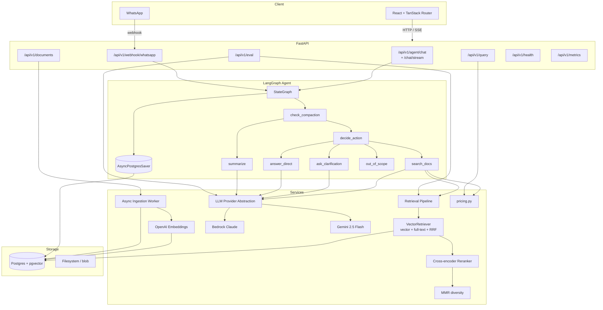
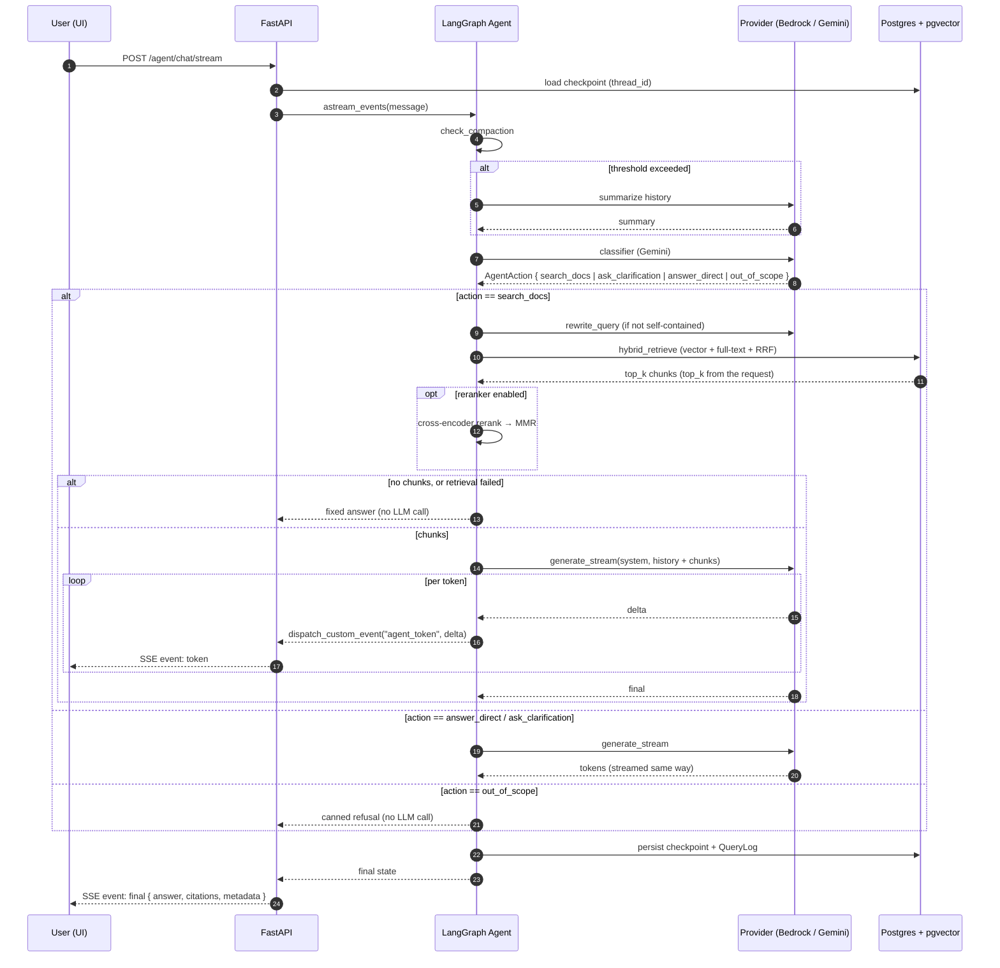
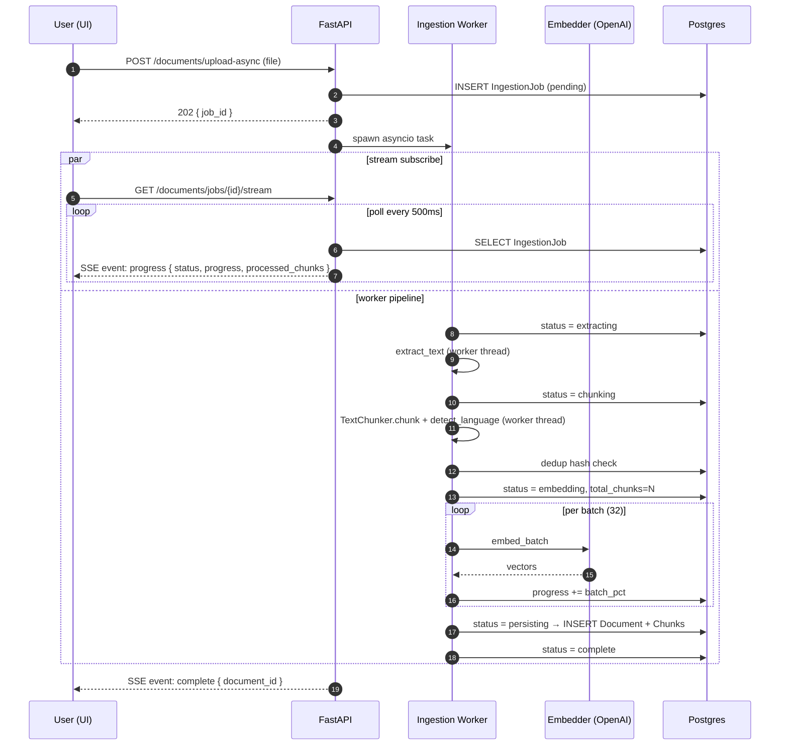
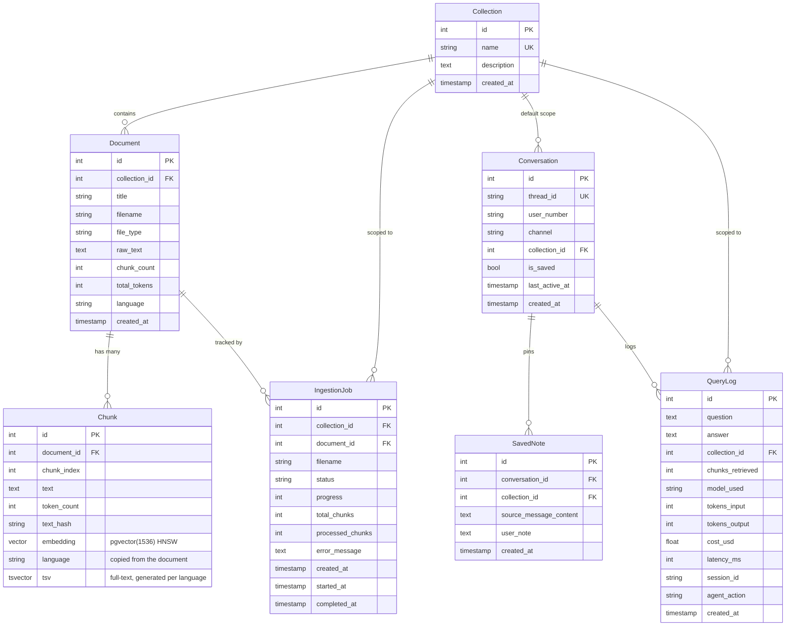

# Architecture

Reference document for the WhisperDocs system. Companion to [`README.md`](README.md).
Decision records under [`docs/adr/`](docs/adr/) explain *why* the major shapes
were chosen.

---

## Component diagram



---

## Sequence: agent chat (streaming)



---

## Sequence: async ingestion



Parsing, chunking and language detection are CPU-bound, so the worker and the
synchronous upload run them with `asyncio.to_thread`. The thread does not make
the parse faster: pdfplumber still holds the GIL while it computes. It keeps
the event loop serving, because the interpreter switches threads every 5 ms.
On a 60-page text PDF (about 9 s of parsing) the loop used to stop for the whole
parse; now its longest pause is a full garbage collection, which also holds the
GIL. pdfminer allocates enough objects to trigger several. Freezing the objects
allocated at startup (`gc.freeze()` in the lifespan) brought the longest pause
from about 300 ms to about 150 ms. Removing it would mean parsing in a separate
process.

The uploaded bytes live only in the API process's memory, so a job cannot
outlive the process:
- Running jobs are kept in a set until they end. asyncio holds tasks only by
  weak reference, and a task nobody held could be collected mid-way.
- On shutdown, jobs get 5 s to finish (under Docker's 10 s stop timeout).
  Then they are cancelled and marked `failed`, with a message to upload the
  file again.
- On startup, jobs still unfinished in the table (left by a process that was
  killed) are marked `failed` the same way. This assumes one process runs
  ingestion, as compose and the Dockerfile do.
- Persisting the bytes and retrying would need a job queue.

---

## Data model



LangGraph checkpointer state lives in dedicated tables managed by
`langgraph-checkpoint-postgres` (not modeled here).

---

## State contract

`AgentState` (`app/agent/state.py`) is the central data structure flowing
between graph nodes. Splits into two lifetimes:

- **Persistent** (survive across turns via checkpointer): `messages`,
  `summary`, `summary_covered_count`, `collection_id`.
- **Transient** (reset by `check_compaction` each turn): `pending_action`,
  `retrieved_chunks`, `metadata`.

Per-request values that are not conversation state travel in the run config,
not in `AgentState`: `config["configurable"]` carries `thread_id` and the
request's `top_k`, which `search_docs` reads (`AGENT_RETRIEVAL_TOP_K` when
absent).

Each node is a pure async function `(AgentState) -> dict` returning only the
fields it modifies; a node that needs the run config also takes
`config: RunnableConfig`. The graph wires nodes in `app/agent/graph.py`; nodes
never import each other directly. Nodes reach an LLM only through
`llm_service_for(alias)` and the `LLMProvider` interface, never through a
provider SDK.

---

## Retrieval pipeline

`app/services/retrieval_pipeline.py::retrieve()` composes:

1. **Hybrid fetch** — `VectorRetriever.hybrid_retrieve(query_text, query_embedding, ...)`
   - Vector search via cosine distance + HNSW index on `chunks.embedding`,
     with `hnsw.iterative_scan = relaxed_order` so the collection filter
     does not starve the scan (needs pgvector >= 0.8.0). When a filtered
     search still returns fewer than `top_k` rows, it is repeated as an
     exact scan of the collection's chunks; see ADR 0002
   - Full-text search (`VectorRetriever.lexical_retrieve`): OR over the
     question's lexemes, ranked by `ts_rank_cd` (Postgres cover-density
     ranking, not BM25). `chunks.tsv` is generated with the configuration of
     the chunk's language (`wd_english`, `wd_spanish`, `wd_simple`), all
     accent-insensitive; see `app/services/fulltext.py` and alembic `0013`
   - Fused with Reciprocal Rank Fusion (`1 / (k + rank)`, `k=60`) in
     `fuse_rrf`
2. **Cross-encoder rerank** (optional, `RERANKER_ENABLED=true`)
   - `BAAI/bge-reranker-base` via `sentence-transformers`
   - Scores `(query, chunk_text)` pairs, sorts by score, normalizes to 0-1
3. **MMR diversity** (optional, `MMR_ENABLED=true`)
   - Document-level penalty: `λ * relevance(c) − (1−λ) * I[doc(c) ∈ selected_docs]`
   - λ=1.0 → pure relevance; λ=0.0 → pure diversity

Pool sizing: when reranking or MMR is active, the pipeline fetches
`fetch_k = max(top_k, RERANKER_CANDIDATE_POOL)` candidates (20 by default);
otherwise `fetch_k = top_k`. Each leg of the hybrid search returns
`max(fetch_k, 20)` rows before fusion, so RRF always works from at least 20
per leg, and a pool above 20 reaches the reranker in full.

Context budget: `build_user_prompt` (`app/services/rag.py`) renders the
numbered context block for `/query`, the eval and the agent's `search_docs`,
and keeps the chunks that fit `AGENT_RAG_CONTEXT_TOKEN_BUDGET` (6000 tokens).
Citations, citation validation and the eval's hallucination judge use those
chunks; retrieval precision and recall use every retrieved chunk.

Scores on `RetrievedChunk`: `relevance` is what the list is ordered by, 0-1:
the RRF score divided by the best possible (1.0 = first in every leg that
returned rows), or the cross-encoder score after reranking. `cosine` is the
vector similarity, `None` for chunks only full-text search found. MMR uses
`relevance`; the `retrieval_top_relevance` metric uses the best `cosine`.

`scripts/retrieval_bench.py` measures each leg and the fused result on the
golden set (rows returned, precision@k, recall@k) without LLM calls. Results
before and after the full-text rework are in ADR 0003.

---

## Provider abstraction

```python
class LLMProvider(Protocol):
    async def generate(...) -> LLMResponse: ...
    async def generate_structured(...) -> tuple[T, LLMResponse]: ...
    def generate_stream(...) -> AsyncIterator[LLMStreamDelta]: ...
```

`app/services/llm/__init__.py::llm_service_for(node_alias)` routes by config:

| Alias | Default model | Provider |
|-------|---------------|----------|
| `classifier` | `gemini-3.8-flash` | Gemini |
| `query_rewrite` | `gemini-3.8-flash` | Gemini |
| `clarification` | `gemini-3.8-flash` | Gemini |
| `answer_direct` | `gemini-3.8-flash` | Gemini |
| `rag` | `us.anthropic.claude-sonnet-4-5-20250929-v1:0` | Bedrock |
| `summarize` | `us.anthropic.claude-haiku-4-5-20251001-v1:0` | Bedrock |
| `eval_judge` | `gemini-3.8-flash` | Gemini |

Override per node via `AGENT_MODEL_<ALIAS>` env vars. Model rules live in
`app/services/llm/model_policy.py`:

- **Sampling.** `temperature` is sent only to models that accept it. Gemini 3+
  and Claude 4.7+ use fixed sampling, so `AGENT_TEMP_*` has no effect on them.
- **Gemini 3.** `GEMINI_THINKING_LEVEL` (default `low`) sets `thinking_level`.
  `gemini-3.8-flash` is served from the `global`, `us` and `eu` locations
  only, so `GCP_LOCATION` defaults to `global`.
- **Claude 4.7+.** Served on Bedrock only by the Messages endpoint
  (`bedrock-mantle`), not by Converse, which `BedrockProvider` uses. Those IDs
  are rejected.
- **Startup check.** `app/main.py` refuses to start when a configured model
  can't be routed or is rejected, and logs a warning for a model with no row
  in `pricing.py` (its cost falls back to a generic rate).

Retries:
- **Bedrock.** botocore is set to a single attempt, and `BedrockProvider`
  retries throttling, 5xx and model timeouts itself: up to 3 attempts, with
  backoff from 0.3 s. `generate_stream` retries only until the first token. After
  that, the client has already shown text, so the error ends the turn.
- **Gemini.** The google-genai SDK retries (`max_retries=2`).

---

## Eval framework

`app/eval/` is a self-contained subsystem:

- `schemas.py` — `TestItem`, `EvalResult`, `AggregateMetrics`, `EvalReport`
- `runner.py` — CLI: `run` and `diff` subcommands, JSONL or JSON dataset loaders
- `evaluator.py` — orchestrator (loads dataset, embeds, retrieves, generates, judges)
- `judges.py` — LLM-as-judge for correctness + hallucination
- `metrics.py` — aggregation: precision and recall@k over the in-scope items,
  p50/p95, generation cost via shared `pricing.py`, count of failed judge calls
- `report.py` — Markdown rendering + diff between runs

The evaluator calls the retrieval pipeline and the single-turn RAG prompt
(`app/services/rag.py`) directly; it does not run the agent graph. The
retrieval, the prompt and its context budget are the ones the chat uses. The
classifier, query rewrite and history handling are covered by the unit tests in
`tests/agent/`. A run aborts (`EvalAbortedError`, exit code 2 from the CLI,
HTTP 502 from `/eval/run`) when the share of failed judge calls exceeds
`AGENT_EVAL_MAX_JUDGE_ERROR_RATE` (default 0.1).

Dataset format (`eval/golden/queries.jsonl`):

```jsonl
{"id": 1, "question": "...", "expected_answer": "...", "difficulty": "medium", "category": "in_scope", "expected_sources": ["foo.md"]}
```

The same retrieval pipeline (`retrieval_pipeline.retrieve`) is used in eval and
production — toggling reranker / MMR via env vars produces an apples-to-apples
A/B run.

---

## Observability

- **Logs** — `structlog` with JSON output in production (`LOG_JSON=1`),
  console-pretty otherwise. `merge_contextvars` ready for `request_id` /
  `trace_id` propagation.
- **Metrics** — Prometheus `/metrics` endpoint:
  - `whisperdocs_agent_turn_duration_seconds{action}` — whole turn, recorded
    by `/agent/chat`, `/agent/chat/stream` and the WhatsApp webhook
  - `whisperdocs_llm_tokens_total{model,direction}` — RAG generation calls only
  - `whisperdocs_retrieval_chunks` (histogram)
  - `whisperdocs_retrieval_top_relevance` (histogram)
  - `whisperdocs_errors_total{type}`
- **Cost tracking** — `query_logs.cost_usd` populated per turn via `pricing.estimate_cost_usd(model, tokens_in, tokens_out)`.
- **Health** — `/health` with `?deep=true` checks DB ping + pgvector extension + embedder reachability.

---

## Testing strategy

- **Unit** — Each agent node tested in isolation with `FakeProvider` and a
  mocked retrieval pipeline (`tests/agent/conftest.py`). Streaming nodes get a
  `generate_stream` stub that yields the canned response.
- **Service** — `test_chunker.py`, `test_reranker.py`, `test_mmr.py` exercise
  pure-function services without DB.
- **Integration (TODO)** — `pytest-postgresql` / testcontainers wiring not yet
  in CI.
- **E2E** — Eval suite acts as integration: ingest fixture corpus, query, judge.

`tests/agent/conftest.py::mock_retriever` patches both
`retrieval_pipeline.retrieve` *and* the rebound names in importing modules so
either entry point sees the same stub data.

---

## Decision records

See [`docs/adr/`](docs/adr/) for short rationale notes:

- [0001 — LangGraph over chained LCEL](docs/adr/0001-langgraph-over-lcel.md)
- [0002 — pgvector over a dedicated vector DB](docs/adr/0002-pgvector-over-dedicated-vectordb.md)
- [0003 — Hybrid retrieval with RRF](docs/adr/0003-hybrid-retrieval-rrf.md)
- [0004 — Dual LLM provider routing](docs/adr/0004-dual-llm-provider-routing.md)
