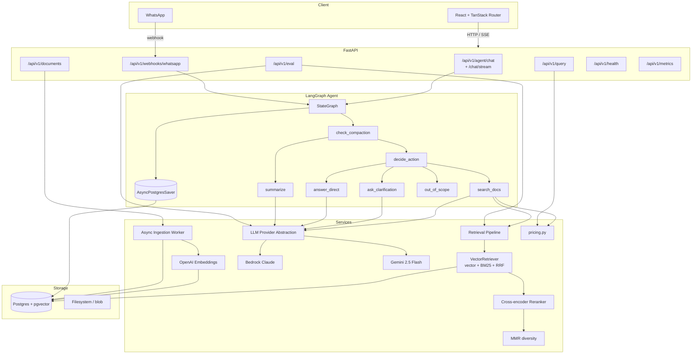
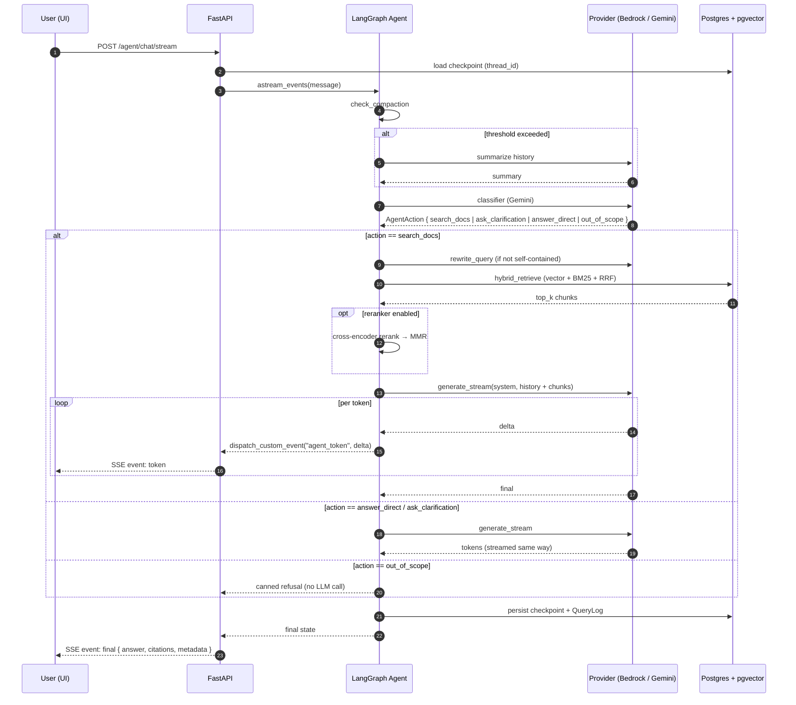
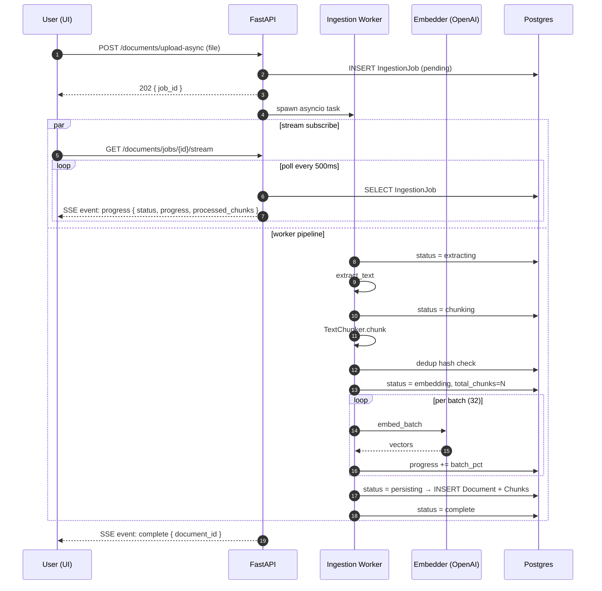
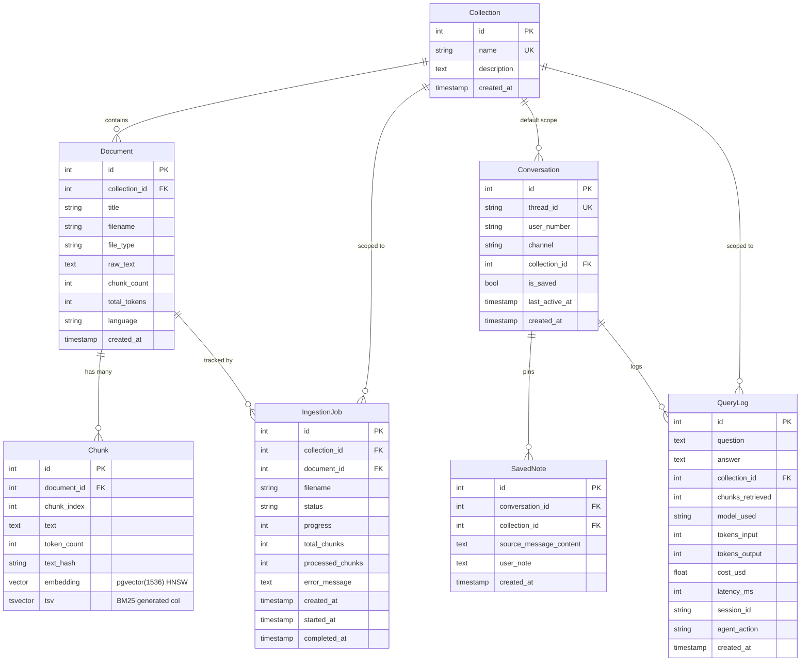

# Architecture

Reference document for the WhisperDocs system. Companion to [`README.md`](README.md).
Decision records under [`docs/adr/`](docs/adr/) explain *why* the major shapes
were chosen.

---

## Component diagram



---

## Sequence: agent chat (streaming)



---

## Sequence: async ingestion



---

## Data model



LangGraph checkpointer state lives in dedicated tables managed by
`langgraph-checkpoint-postgres` (not modeled here).

---

## State contract

`AgentState` (`app/agent/state.py`) is the central data structure flowing
between graph nodes. Splits into two lifetimes:

- **Persistent** (survive across turns via checkpointer): `messages`,
  `summary`, `pending_action`, `collection_id`, `metadata`, `user_number`,
  `channel`, `notes_pinned`, `turn_count`.
- **Transient** (reset by `check_compaction` each turn): `retrieved_chunks`,
  `top_k`.

Each node is a pure async function `(AgentState) -> dict` returning only the
fields it modifies. The graph wires nodes in `app/agent/graph.py`; nodes never
import each other directly. See `.claude/rules/agent.md` for the full contract.

---

## Retrieval pipeline

`app/services/retrieval_pipeline.py::retrieve()` composes:

1. **Hybrid fetch** — `VectorRetriever.hybrid_retrieve(query_text, query_embedding, ...)`
   - Vector search via cosine distance + HNSW index on `chunks.embedding`
   - BM25 via `ts_rank_cd(c.tsv, websearch_to_tsquery(...))`
   - Fused with Reciprocal Rank Fusion (`1 / (k + rank)`, `k=60`)
2. **Cross-encoder rerank** (optional, `RERANKER_ENABLED=true`)
   - `BAAI/bge-reranker-base` via `sentence-transformers`
   - Scores `(query, chunk_text)` pairs, sorts by score, normalizes to 0-1
3. **MMR diversity** (optional, `MMR_ENABLED=true`)
   - Document-level penalty: `λ * relevance(c) − (1−λ) * I[doc(c) ∈ selected_docs]`
   - λ=1.0 → pure relevance; λ=0.0 → pure diversity

Pool sizing: when reranking is active, `hybrid_retrieve` fetches
`max(top_k, RERANKER_CANDIDATE_POOL=20)` candidates. Without reranking,
`top_k` directly.

---

## Provider abstraction

```python
class LLMProvider(Protocol):
    async def generate(...) -> LLMResponse: ...
    async def generate_structured(...) -> tuple[T, LLMResponse]: ...
    def generate_stream(...) -> AsyncIterator[LLMStreamDelta]: ...
```

`app/services/llm/__init__.py::llm_service_for(node_alias)` routes by config:

| Alias | Default model | Provider |
|-------|---------------|----------|
| `classifier` | `gemini-2.5-flash` | Gemini |
| `query_rewrite` | `gemini-2.5-flash` | Gemini |
| `clarification` | `gemini-2.5-flash` | Gemini |
| `answer_direct` | `gemini-2.5-flash` | Gemini |
| `rag` | `us.anthropic.claude-sonnet-4-5-20250929-v1:0` | Bedrock |
| `summarize` | `us.anthropic.claude-haiku-4-5-20251001-v1:0` | Bedrock |
| `eval_judge` | `gemini-2.5-flash` | Gemini |

Override per node via `AGENT_MODEL_<ALIAS>` env vars.

---

## Eval framework

`app/eval/` is a self-contained subsystem:

- `schemas.py` — `TestItem`, `EvalResult`, `AggregateMetrics`, `EvalReport`
- `runner.py` — CLI: `run` and `diff` subcommands, JSONL or JSON dataset loaders
- `evaluator.py` — orchestrator (loads dataset, embeds, retrieves, generates, judges)
- `judges.py` — LLM-as-judge for correctness + hallucination
- `metrics.py` — aggregation: precision, recall@k, p50/p95, cost via shared `pricing.py`
- `report.py` — Markdown rendering + diff between runs

Dataset format (`eval/golden/queries.jsonl`):

```jsonl
{"id": 1, "question": "...", "expected_answer": "...", "difficulty": "medium", "category": "in_scope", "expected_sources": ["foo.md"]}
```

The same retrieval pipeline (`retrieval_pipeline.retrieve`) is used in eval and
production — toggling reranker / MMR via env vars produces an apples-to-apples
A/B run.

---

## Observability

- **Logs** — `structlog` with JSON output in production (`LOG_JSON=1`),
  console-pretty otherwise. `merge_contextvars` ready for `request_id` /
  `trace_id` propagation.
- **Metrics** — Prometheus `/metrics` endpoint:
  - `whisperdocs_agent_turn_duration_seconds{node}`
  - `whisperdocs_llm_tokens_total{provider,model,direction}`
  - `whisperdocs_retrieval_chunks{collection}`
  - `whisperdocs_retrieval_top_relevance` (histogram)
  - `whisperdocs_errors_total{type}`
- **Cost tracking** — `query_logs.cost_usd` populated per turn via `pricing.estimate_cost_usd(model, tokens_in, tokens_out)`.
- **Health** — `/health` with `?deep=true` checks DB ping + pgvector extension + embedder reachability.

---

## Testing strategy

- **Unit** — Each agent node tested in isolation with `FakeProvider` and a
  mocked retrieval pipeline (`tests/agent/conftest.py`). Streaming nodes get a
  `generate_stream` stub that yields the canned response.
- **Service** — `test_chunker.py`, `test_reranker.py`, `test_mmr.py` exercise
  pure-function services without DB.
- **Integration (TODO)** — `pytest-postgresql` / testcontainers wiring not yet
  in CI.
- **E2E** — Eval suite acts as integration: ingest fixture corpus, query, judge.

`tests/agent/conftest.py::mock_retriever` patches both
`retrieval_pipeline.retrieve` *and* the rebound names in importing modules so
either entry point sees the same stub data.

---

## Decision records

See [`docs/adr/`](docs/adr/) for short rationale notes:

- [0001 — LangGraph over chained LCEL](docs/adr/0001-langgraph-over-lcel.md)
- [0002 — pgvector over a dedicated vector DB](docs/adr/0002-pgvector-over-dedicated-vectordb.md)
- [0003 — Hybrid retrieval with RRF](docs/adr/0003-hybrid-retrieval-rrf.md)
- [0004 — Dual LLM provider routing](docs/adr/0004-dual-llm-provider-routing.md)
